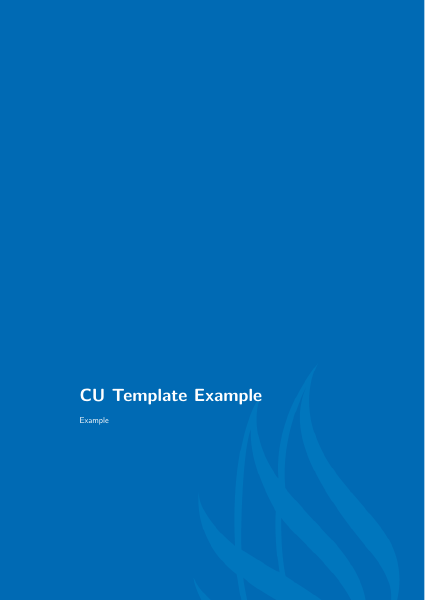

# CU Template PDF Skills

A set of pi skills for turning Markdown into Coventry University-branded PDFs with Pandoc and XeLaTeX. The main skill includes the LaTeX template and branding assets.

## Install with an AI coding client

In your favourite AI coding client, enter:

```text
Install https://github.com/jbrusey/cu-template-skill as a skill.
```

- [Install and use with pi](PI.md)
- [Manual setup and build](BUILD.md)

## Markdown input

Add Pandoc YAML metadata when you want a title page:

```yaml
---
title: "Project title"
subtitle: "Optional subtitle"
author: "Author name"
date: "Version 1.0"
lang: en-GB
---
```

Use headings, lists, tables, links, images, and emphasis. Raw LaTeX such as `\vspace{8mm}` is also supported. The output includes the CU title page, colours, typography, page numbers, background image, logo, and closing page.

## Example

The repository includes a small Markdown example with lorem ipsum text, a table, and a figure:

[View the example PDF](examples/example.pdf)

[](examples/example.pdf)
